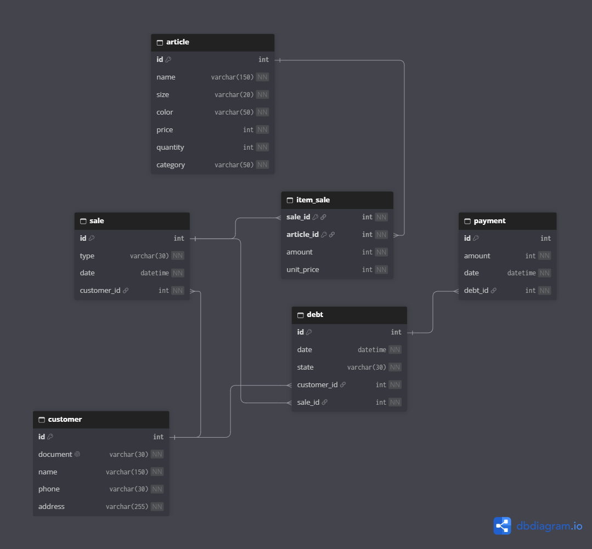
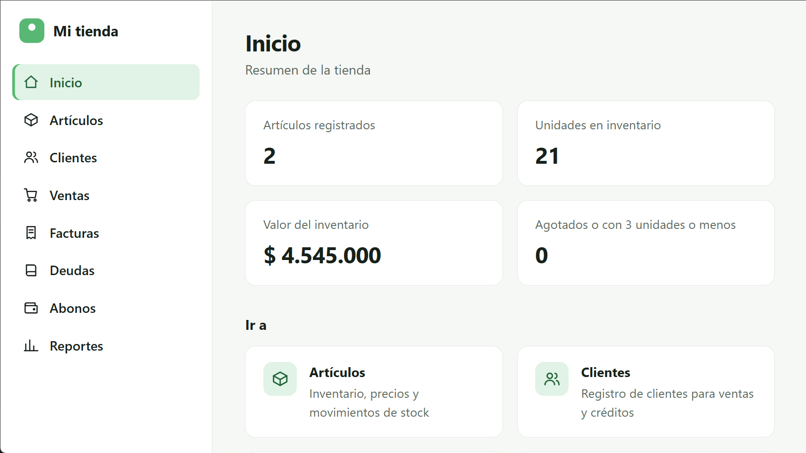
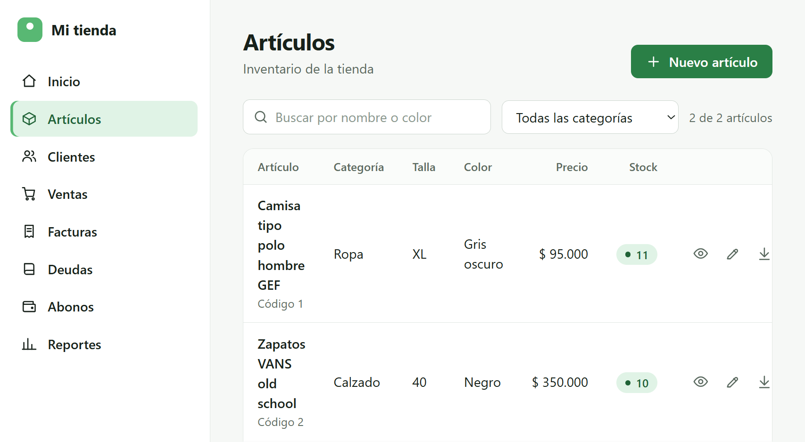
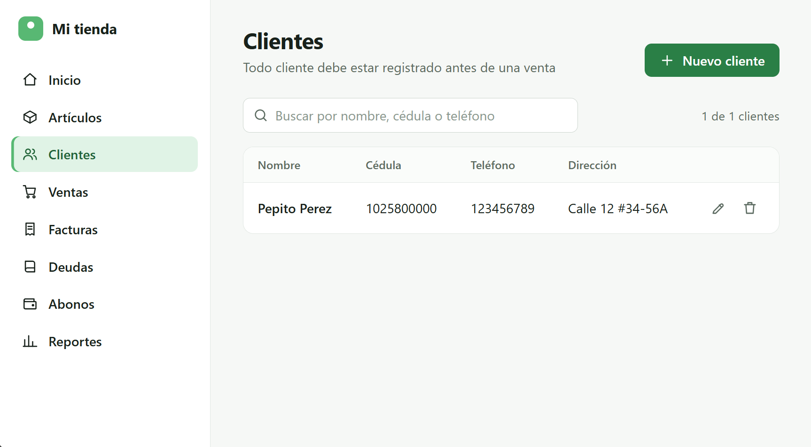
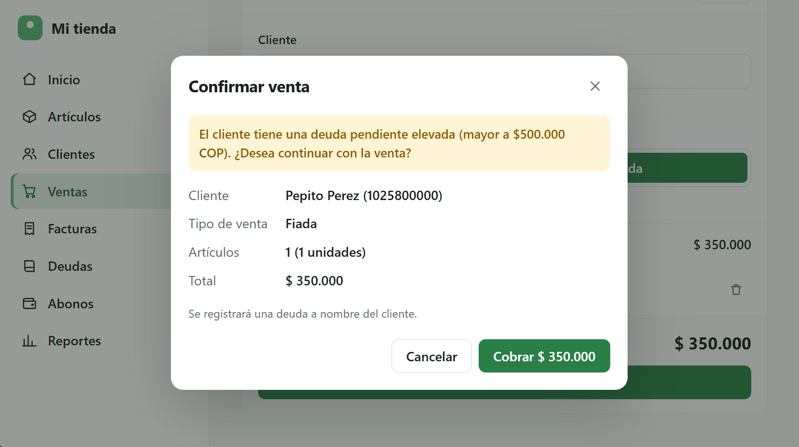
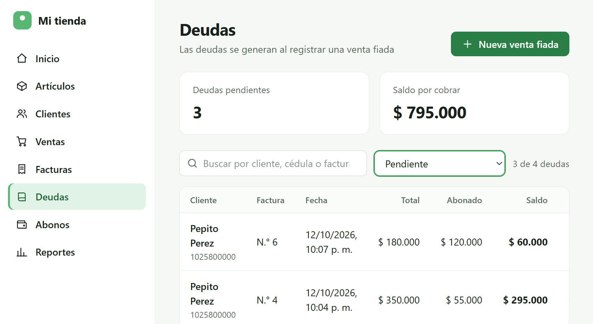

# clothing-store-management-spring-boot
Spring Boot API REST for clothing store management: articles, customers, sales,
debts and payments. *This is an ongoing project, built for learning and 
continuously updated as I learn new concepts and improvements.*

## Features 

* Basic CRUD operations across entities.
* Cash/Credit sales with automatic debt generation and payment management.
* Transaction history.

## Architecture

The app is built under a multi-layer architecture featuring `controller`, `service`,
`repository`, `model`, `exception` and `dto`.

## Technologies Used

* Java
* Spring Boot
* JPA
* Spring Data
* MySQL
* HTML/CSS/JS

## Database Design

## Design Choices

* Usage of a fail-fast approach across all entities to abort immediate app execution and throw exceptions when an error occurs.
* Multiple entities constructors for different cases.
* Categories and states enums.
* Defined custom exceptions.
* Implemented some custom JpaRepository methods and JPQL Queries.
* Usage of DTOs to transfer data between API requests and the application layer.

## Next Steps / To Do

* Implement Spring Security.
* Add request validations using Jakarta Bean Validation.
* Improve DTOs to avoid exposing data.
* Add unit tests and integration tests.
* API documentation.

### Note

_As this project focuses primarily on my backend and Spring Boot learning process,
AI tools were used to help with frontend implementation, allowing me to dedicate
more time to API design, business logic and data persistence._

## Screenshots

